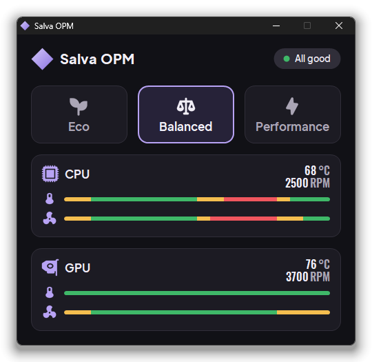
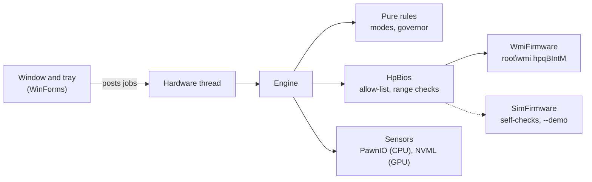

# Salva OPM

**Salva OPM** (OMEN Power Manager) is a Windows tray app that replaces OMEN Gaming Hub's performance control on one laptop, the HP OMEN 16-ap0 (board 8E35). It switches between three power modes, shows the chip temperatures and fan speeds, and talks to the laptop's firmware directly through HP's BIOS WMI interface. The fans stay on the firmware's own curve.

[](https://github.com/127salva/salva-opm/actions/workflows/ci.yml)
[](https://github.com/127salva/salva-opm/releases/latest)
[](LICENSE)



*The window, from `--demo` (simulated firmware and sensors).*

> [!WARNING]
> It writes to the laptop's firmware and was built and tested on one laptop only (OMEN 16-ap0xxx, BIOS F.13). On any other model the setup refuses to install and the app refuses to run. It is a personal tool, provided as is with no warranty ([LICENSE](LICENSE)). The firmware's own thermal protections always stay in charge.

## What it does
- **Three modes:** Eco, Balanced and Performance. Performance is HP's "Unleashed" profile (CPU limits 80 W, GPU at maximum power) and needs the charger.
- **Readings:** CPU and GPU temperature and fan speed, with a 10-minute history in level colours (green, amber, red). The app only reads the fans; the firmware's own curve drives them.
- **Safety rules:** OMEN Gaming Hub's battery-drain and chassis-temperature rules in Performance. On an unexpected error the app hands power back to the firmware and stops writing.
- **Power events:** unplugging switches to Eco, plugging back in to Balanced. Performance never survives a restart.
- **One file:** `SalvaOPM-Setup.exe` installs, updates and uninstalls. The app never uses the network.

Every firmware call and every change to the PC is listed in [docs/what-it-does.md](docs/what-it-does.md).

## How it works


- **Allow-list at the transport.** Every BIOS call the app may send (command, type, sizes) is listed in `FirmwareRules`. Anything else, including every fan command, is refused before it is sent, and values outside their range throw instead of being clamped.
- **Read-back instead of return codes.** The firmware answers `0` even to writes it ignores (measured). Power and GPU writes are read back.
- **The firmware is the fallback.** The firmware drops host power limits and the profile about two minutes after the last refresh. The app relies on this: after a crash the laptop returns to its own control by itself. The GPU record and concurrent TDP do not lapse; the app puts them back at its next start.
- **One hardware thread.** All firmware work runs as jobs on one background thread, so the window never waits for a WMI call.
- **A simulator for every hardware interface.** The engine only sees interfaces (firmware, sensors, power source). Each has a simulated twin, which runs the whole engine in the self-checks and in `--demo`.

The reasons behind each decision are in [docs/architecture.md](docs/architecture.md). How each firmware fact was found (decoded, taken from other projects, or measured) is in [docs/firmware.md](docs/firmware.md).

## Tech stack
| Part | Used |
|---|---|
| Language and UI | C# 5, WinForms, .NET Framework 4.8; owner-drawn controls; Plus Jakarta Sans and Oswald (both embedded, SIL OFL) |
| Build | `csc.exe` that ships with Windows; one batch file, no SDK, no NuGet packages |
| Firmware | HP BIOS WMI interface (`root\wmi`, class `hpqBIntM`) through `System.Management` |
| CPU temperature | [PawnIO](https://pawnio.eu) driver with its signed `AMDFamily17` module |
| GPU temperature | NVIDIA `nvml.dll` |
| Start at logon | Task Scheduler task with highest privileges (COM) |
| CI | GitHub Actions on `windows-latest`: build, self-checks, SHA-256 of the setup |

## Testing
- **Self-checks** (`src/SelfCheck.cs`): one assert-based suite, no framework. It covers the mode rules, the governor, the allow-list for every BIOS type 0–255 (no fan command passes), and the engine end to end against the simulator. It also runs 14 simulated days with random load, sleep, unplugging and failing BIOS calls, and checks the safety limits every 5 s. The build and CI stop on any failure.
- **On the laptop:** what only real hardware can answer (the firmware's behaviour, install and uninstall, sleep, 8 hours in Performance) was checked by hand and read from the app's log. [docs/testing.md](docs/testing.md) shows, feature by feature, what was seen on the laptop and what was checked in the simulator only.

## Install
1. Download `SalvaOPM-Setup.exe` from the [latest release](https://github.com/127salva/salva-opm/releases/latest).
2. Check it in PowerShell: `Get-FileHash .\SalvaOPM-Setup.exe` must print the SHA-256 published with the release.
3. Run it, choose **Install** and approve the administrator prompt.

The exe is not code-signed, so SmartScreen warns about an unknown publisher ("More info", then "Run anyway"). Compare the hash first.

The setup installs the PawnIO driver when it is missing or older than 2.2.0 (downloaded once from its official release, hash-checked) and **removes OMEN Gaming Hub**. Run the setup again to update or uninstall. Uninstall puts the firmware back and removes the app. It does not reinstall OMEN Gaming Hub (get it from the Microsoft Store). The full list of steps is in [docs/what-it-does.md](docs/what-it-does.md).

## Build and run without hardware
Requirements: Windows 11, or Windows 10 1903 or later, x64. Nothing to install.

```bat
build.cmd
dist\SalvaOPM-Setup.exe --demo
```

| Command | Result |
|---|---|
| `build.cmd` | compiles with warnings as errors, runs the self-checks, builds `dist\SalvaOPM-Setup.exe` |
| `build.cmd selftest` | compiles and runs only the self-checks |
| `build.cmd app` | builds only the setup exe |
| `SalvaOPM-Setup.exe --demo` | the whole app against the simulator; no administrator rights, no Windows setting changed |

Other switches: `--selftest`, `--check` (prerequisites), `--read` and `--dry-run [minutes]` (read-only, administrator). The exe is a GUI program: in PowerShell, pipe it to `Out-Host` to see the output and keep the exit code (`& .\dist\SalvaOPM-Setup.exe --selftest | Out-Host`).

## Repository layout
```
src/           the app, setup and self-checks (C# 5, WinForms)
res/           app icon, window icons and manifest
third_party/   the PawnIO CPU module (LGPL), the two fonts (OFL), the icon licence (MIT); the PawnIO driver is downloaded by the setup, never shipped
docs/          what it does, architecture, firmware facts, testing, troubleshooting
.github/       CI workflow, bug report template
build.cmd      the build
```

## Documentation
| Document | For |
|---|---|
| [docs/what-it-does.md](docs/what-it-does.md) | everything the app touches, mode by mode |
| [docs/architecture.md](docs/architecture.md) | modules, timing, design decisions |
| [docs/firmware.md](docs/firmware.md) | how each firmware fact was found |
| [docs/testing.md](docs/testing.md) | the self-checks and how each feature was checked |
| [docs/troubleshooting.md](docs/troubleshooting.md) | warnings, logs, recovery |

## Credits and license
- The logic for the power presets, the heartbeat and OMEN Gaming Hub handling follows [Ohman](https://github.com/P4R1H/Ohman) (GPL-3.0-or-later); files with adapted code say so in their header.
- CPU temperature through [PawnIO](https://pawnio.eu) and its `AMDFamily17` module ([third_party/README.md](third_party/README.md)).
- Fonts: [Plus Jakarta Sans](https://github.com/tokotype/PlusJakartaSans) and [Oswald](https://github.com/googlefonts/OswaldFont) (SIL Open Font License 1.1).
- The scale and bolt icons are adapted from [Phosphor Icons](https://phosphoricons.com) (MIT); the other icons were drawn for this app ([third_party/README.md](third_party/README.md)).
- The firmware interface was cross-checked against the Linux kernel's `hp-wmi` driver.

Copyright (C) 2026 127salva. Licensed under [GPL-3.0-or-later](LICENSE). HP and OMEN are trademarks of HP Inc.; this project is not affiliated with or endorsed by HP.
